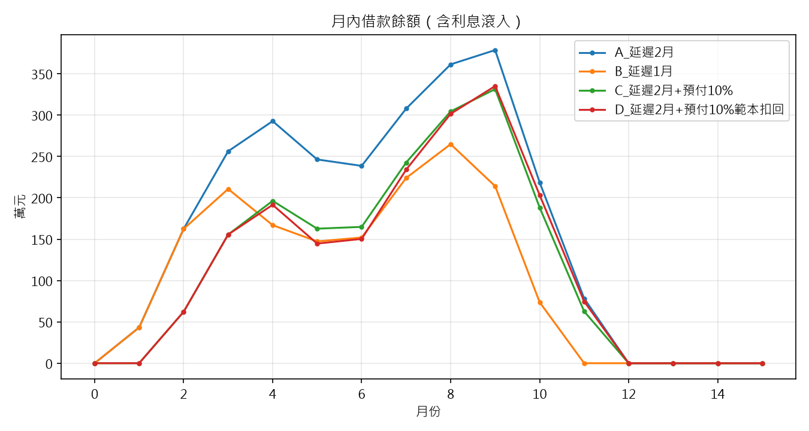

# Construction Cash Flow Simulator

Model a contractor's month-by-month cash position on a construction project and
see how payment terms change the money you need to borrow.

Payment delays, retention and advance payments decide how long a contractor
carries project costs before the owner pays. This tool takes a cost-loaded
schedule and a set of payment terms, simulates borrowing and interest month by
month, and reports the funding gap, the peak loan balance and the total
financing cost for each scenario, so payment terms can be compared before a
contract is signed.



## Features

- **Item-level cost loading**: allocate the cost and contract price of each
  estimate item to months from its progress plan, with an optional payment lag
  per item.
- **Separate cost, billing and cash tracking**: certified billing is never
  counted as cash; receipts arrive only after the payment delay.
- **Retention and advance payments**: retention is withheld from every
  certified payment and released in a chosen month. An advance payment is
  recovered either as a fixed share of each certified payment or, as in
  Taiwan's standard public works contract, in proportion to billing while
  cumulative billing is between 20% and 80% of the contract price.
- **Borrowing and interest**: shortfalls are borrowed, interest accrues
  monthly, unpaid interest is capitalised, and surplus cash repays the loan.
- **Scenario comparison**: run any number of payment scenarios against the same
  project and get a summary table, monthly ledgers and charts.
- **Built-in checks**: every run verifies that cash is conserved and that
  retention and advance payments are fully settled.

## Quick start

Requires Python 3.10 or later.

```bash
git clone https://github.com/Lother13501350/construction-cashflow-simulator.git
cd construction-cashflow-simulator
python -m venv .venv
```

Activate the environment and install dependencies:

```powershell
# Windows (PowerShell)
.\.venv\Scripts\Activate.ps1
```

```bash
# macOS / Linux
source .venv/bin/activate
```

```bash
pip install -r requirements.txt
python src/run.py
```

This runs every scenario in `data/scenarios.csv` against the sample project and
writes the results to `output/`. To explore the results interactively, open
`main.ipynb` with Jupyter and run all cells:

```bash
jupyter notebook main.ipynb
```

## Usage

### 1. Describe the project

**`data/items.csv`**: one row per estimate item.

| Column | Type | Description |
|---|---|---|
| `item_id` | int | Unique item identifier |
| `name` | str | Item description |
| `category` | str | Grouping label, for reporting only |
| `cost` | number | Contractor's cost to perform the item |
| `contract_price` | number | Amount billable to the owner for the item |
| `cost_pay_lag` | int ≥ 0 | Months between doing the work and paying for it (0 = paid at the start of the same month) |

**`data/progress.csv`**: one row per item, one column per month (`M1`, `M2`,
…). Each value is the fraction of the item completed in that month. Each row
must sum to 1; the loader rejects the file otherwise and names the offending
items.

### 2. Define payment scenarios

**`data/scenarios.csv`**: one row per scenario.

| Column | Example | Description |
|---|---|---|
| `scenario` | `A_延遲2月` | Scenario name, also used in output file names |
| `payment_delay` | `2` | Months from certification to receipt (received at month end) |
| `retention_rate` | `0.05` | Share of each certified payment withheld as retention |
| `retention_release_month` | `15` | Month in which all retention is released (month end) |
| `advance_rate` | `0.10` | Advance payment as a share of the total contract price, received before work starts (month 0) |
| `advance_recovery_method` | `band` | `proportional` (default) or `band` |
| `advance_recovery_rate` | `0.10` | `proportional` only: share of each certified payment deducted to recover the advance |
| `recovery_band_start` | `0.20` | `band` only: share of the contract price billed before recovery starts |
| `recovery_band_end` | `0.80` | `band` only: share of the contract price billed when recovery is complete |
| `initial_cash` | `0` | Cash on hand at month 0 |
| `annual_rate` | `0.06` | Annual interest rate on borrowing |

Add a row to compare another scenario; no code changes are needed. Blank
optional columns fall back to their defaults.

### 3. Run

```bash
python src/run.py
```

### Output

| File | Content |
|---|---|
| `output/summary.csv` | One row per scenario: maximum funding gap, peak loan balance, total interest, ending cash and ending loan |
| `output/ledger_<scenario>.csv` | Monthly ledger: costs paid, certified billing, retention, advance recovery, receipts, borrowing, interest, repayment, loan and cash balances |
| `output/item_cost_incurred.csv` | Cost allocated to each item and month |
| `output/item_certified_billing.csv` | Certified billing for each item and month |
| `output/fig_cumulative_cashflow.png` | Cumulative cash flow, excluding interest |
| `output/fig_loan_balance.png` | Loan balance over time |
| `output/fig_s_curve.png` | Cumulative cost and billing S-curves |

## How it works

Time runs in whole months. Month 0 is the period before work starts, when an
advance payment, if any, is received. Every month then follows the same
sequence:

1. **Start of month**: pay the costs due. If cash is short, borrow the
   difference.
2. **During the month**: interest accrues on the loan balance at
   `annual_rate / 12`.
3. **End of month**: receive the payments due, pay the month's interest
   (borrowing any shortfall, which accrues interest from the next month), and
   use the remaining cash to repay the loan.

Work certified in month *t* is received at the end of month
*t* + `payment_delay`, net of retention and advance recovery:

```
received = certified − certified × retention_rate − advance recovery
```

Advance recovery never exceeds the unrecovered balance. With `proportional`
recovery it is `certified × advance_recovery_rate`. With `band` recovery, only
the part of this month's billing that falls between
`recovery_band_start × contract price` and `recovery_band_end × contract price`
(measured on cumulative billing) counts, at a rate that recovers the whole
advance across the band:

```
band recovery = advance ÷ ((band_end − band_start) × contract price)
                × billing that falls inside the band this month
```

All retention is released at the end of `retention_release_month`. The
simulation runs until every cost has been paid and every receipt, including
retention, has arrived.

### Metrics

| Metric | Definition |
|---|---|
| Maximum funding gap | Largest value of cumulative costs paid minus cumulative receipts minus initial cash, measured after each start-of-month payment. Excludes interest. |
| Peak loan balance | Largest loan balance reached, including capitalised interest. |
| Total interest | Sum of monthly interest charges. |
| Ending cash / ending loan | Balances at the end of the final month. |

The gap between the maximum funding gap and the peak loan balance is the
interest capitalised up to the peak.

## Example results

The sample project is a three-storey reinforced-concrete house with 30
estimate items: NT$10,000,000 contract price, NT$9,000,000 cost, completed in
month 9, with 5% retention released in month 15 and borrowing at 6% a year.

| Payment terms | Max funding gap | Peak loan | Total interest |
|---|---:|---:|---:|
| Paid 2 months after certification | 3,690,498 | 3,785,932 | 129,213 |
| Paid 1 month after certification | 2,592,998 | 2,648,321 | 82,956 |
| Paid after 2 months, with a 10% advance recovered at 10% per payment | 3,249,393 | 3,313,824 | 93,545 |
| Paid after 2 months, with a 10% advance recovered between 20% and 80% billed | 3,288,656 | 3,350,641 | 92,638 |

Paying one month sooner cuts the peak loan by 30%; a 10% advance payment cuts
it by about 12%. How the advance is recovered matters less: recovering it
between 20% and 80% of billing concentrates the deductions in the middle of
the project, which raises the peak loan slightly but lowers total interest.

The sample data is synthetic and does not describe a real project. It is
generated by `src/make_case.py`; running that script overwrites the files in
`data/`.

## Validation

### Automated tests

```bash
python -m pytest
```

The suite includes two small projects whose expected results were calculated
by hand (the working is written out in each test's docstring), a published
worked example of band-based advance recovery on a NT$90,000,000 contract,
and tests for the recovery cap, payment lags, input validation, and
conservation checks on the sample project.

### Independent spreadsheet check

`validation/` rebuilds the same model as an Excel workbook in which every
monthly value is a spreadsheet formula, then compares Excel's results with the
Python results cell by cell. For the sample project, all 768 compared values
match, with a maximum difference of about 6 × 10⁻¹¹ (floating-point rounding
only).

Recalculating the workbook requires Microsoft Excel on Windows:

```powershell
python validation/build_excel_check.py
powershell -ExecutionPolicy Bypass -File validation/recalc_excel.ps1
python validation/compare.py
```

The comparison is written to `validation/comparison_monthly.csv` and
`validation/comparison_summary.csv`.

### Hand-calculation worksheet

`validation/hand_check_worksheet.xlsx` lists 65 values to verify by hand, with
the inputs and method for each but no answer. Fill in the yellow column; each
row then shows ✓ or the difference from the tool's value, which is kept on a
hidden sheet. Regenerate it after changing the sample data:

```bash
python validation/make_hand_check.py
```

## Project structure

```
├── data/            Input files: items, progress plan, payment scenarios
├── output/          Generated results and charts
├── src/
│   ├── cashflow.py      Simulation engine
│   ├── run.py           Command-line entry point
│   ├── make_case.py     Sample data generator
│   └── make_notebook.py Notebook generator
├── tests/           pytest suite
├── validation/      Excel cross-check and comparison scripts
├── main.ipynb       Interactive walkthrough
└── requirements.txt
```

## Limitations

- Monthly resolution: costs and receipts are assumed to fall at the start or
  end of a month.
- No interest is earned on positive cash balances.
- A single interest rate with no credit limit.
- The contract price is fixed; change orders are not modelled.
- Retention is released in a single month.

## Roadmap

- Activity-based schedule input (start month and duration), with a comparison
  of early-start and late-start schedules
- Sensitivity analysis across payment delay, retention rate and interest rate
- Per-item payment terms for subcontractors and suppliers

## Contributing

- Run `python -m pytest` before every commit.
- Write commit messages in English following
  [Conventional Commits](https://www.conventionalcommits.org/), for example
  `feat(engine): add interest on positive cash balances`.
- Keep each commit to one logical change.
